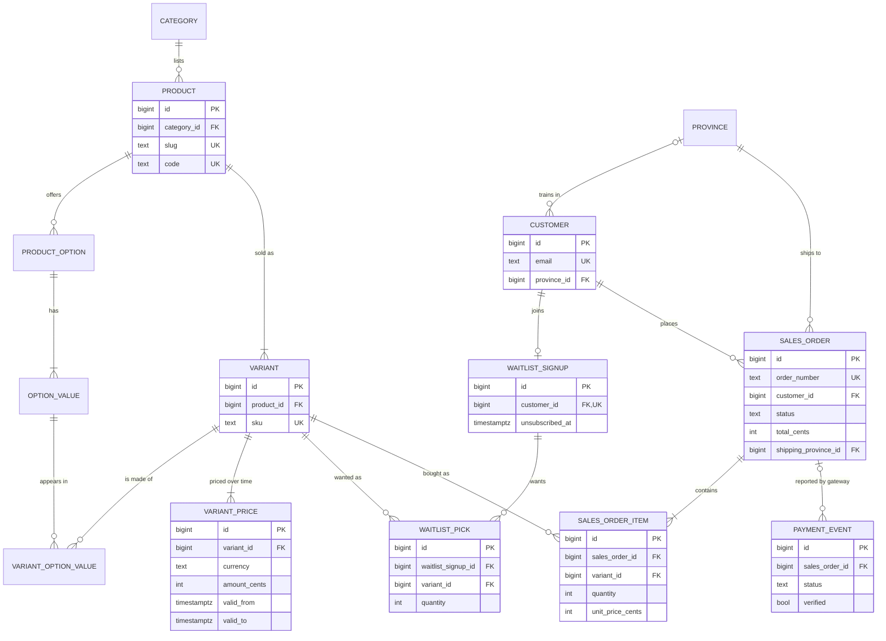

# Database design

Designed with the team's database guide (*Cómo diseñar una base de datos correcta*): business rules first, ERD before
the migration, 3NF, integrity enforced by the database, history on purpose, one naming convention, migrations that are
never edited. Column-by-column details are in [data-dictionary.md](data-dictionary.md), generated from the schema.

## Decisions taken with the business (2026-10-30)

| Question | Decision | Consequence |
|---|---|---|
| Who changes products and prices? | The technical team, through the code | `lib/catalog-data.ts` is the source. Every deploy copies it into the database (`lib/server/catalog-sync.ts`): products, options, variants and prices with validity periods. No admin panel yet. |
| One company or several? | Only Soulset Athletics | No `company_id`, no row-level security per company. |
| Language of table and column names | English | `snake_case`, singular table names. `order` is a reserved word, so orders are `sales_order`. |

Other project-wide choices: ids are `bigint generated always as identity` (all ids stay inside the system; the only one
shown to people is the order number); money is integer cents plus its currency; instants are `timestamptz` (UTC).

## Business process

**Pre-launch (now).** A visitor browses the line-up, adds products to a cart and joins the waitlist with their email,
optionally their first name and the province they train in. The cart goes with the sign-up as their wishlist. They get a
confirmation email with an unsubscribe link. Signing up again updates the same sign-up.

**Launch (built, switched off).** A customer checks out: delivery details, the cart priced by the server, a pending
order, then the payment gateway's hosted page (Azul or CardNet). The gateway reports the result; the order becomes paid,
declined, cancelled or error. A paid order can later be refunded.

What can go wrong: duplicate or fake sign-ups (unique email, rate limit), a browser sending its own prices (prices only
come from the catalogue), a forged payment result (verified with the gateway, order changes once), a bug editing an
order (database triggers).

## Business rules

- R1. A customer is identified by email; one customer per email.
- R2. A customer has at most one waitlist sign-up. Signing up again updates it; unsubscribing marks it, never deletes it.
- R3. A sign-up keeps zero or more picks; each pick is one variant, a quantity from 1 to 99, and whether it's Subscribe & save. New picks replace the old ones.
- R4. The province, when given, is one of the 31 provinces or Distrito Nacional.
- R5. A product belongs to one category and has zero or more options (flavour, pack…); each option has one or more values.
- R6. A variant (SKU) is a product with exactly one value for each of its options, and only values of its own product's options.
- R7. A variant has one list price per currency at any moment; a price change starts a new period and keeps the old one.
- R8. Stacks can't be bought with Subscribe & save.
- R9. An order belongs to one customer, has one or more items, ships to one address in the Dominican Republic, and is paid through one gateway.
- R10. An order's total is its subtotal plus shipping; its subtotal is the sum of quantity × unit price of its items.
- R11. An item records the price actually charged per unit; later price changes don't touch past orders.
- R12. Order status only moves pending → paid | declined | cancelled | error, and paid → refunded. Nothing else about an order changes after it's created, and orders are never deleted.
- R13. Every gateway callback is recorded, verified or not, and never changed.
- R14. Products and variants removed from the catalogue are deactivated, never deleted, so old orders and wishlists keep their references.

## Entities

| Entity (table) | One row is | PK | Natural keys (UNIQUE) |
|---|---|---|---|
| `province` | a Dominican province | `id` | `name` |
| `category` | a shop category | `id` | `slug` |
| `product` | a product as sold on the site | `id` | `slug`, `code` |
| `product_option` | a choice offered for a product | `id` | `(product_id, key)` |
| `option_value` | one possible value of an option | `id` | `(product_option_id, key)` |
| `variant` | a sellable SKU | `id` | `sku` |
| `variant_option_value` | the value a variant has for one option | `id` | `(variant_id, product_option_id)` |
| `variant_price` | a variant's list price during a period | `id` | one current row per `(variant_id, currency)`; periods never overlap |
| `customer` | a person, by email | `id` | `email` |
| `waitlist_signup` | a customer's place on the waitlist | `id` | `customer_id` |
| `waitlist_pick` | one product a signed-up customer wants | `id` | `(waitlist_signup_id, variant_id, is_subscription)` |
| `sales_order` | an order placed at checkout | `id` | `order_number` |
| `sales_order_item` | a line of an order | `id` | `(sales_order_id, variant_id, is_subscription)` |
| `payment_event` | one callback from a gateway | `id` | — |
| `rate_limit_hit` | one request to a rate-limited endpoint | `id` | — |

## Relationships

| From → to | Cardinality | Optionality | ON DELETE |
|---|---|---|---|
| category → product | 1:N | a product must have a category | RESTRICT |
| product → product_option | 1:N | a product may have no options | RESTRICT |
| product_option → option_value | 1:N | an option has at least one value (catalogue sync) | RESTRICT |
| product → variant | 1:N | a product has at least one variant (catalogue sync) | RESTRICT |
| variant ↔ option_value | N:M through `variant_option_value` | one value per option of the variant's product | RESTRICT |
| variant → variant_price | 1:N | a sold variant has a current price | RESTRICT |
| province → customer | 1:N | optional for the customer | RESTRICT |
| customer → waitlist_signup | 1:1 | optional for the customer | RESTRICT |
| waitlist_signup ↔ variant | N:M through `waitlist_pick` | a sign-up may have no picks | RESTRICT |
| customer → sales_order | 1:N | an order must have a customer | RESTRICT |
| province → sales_order (shipping) | 1:N | required for the order | RESTRICT |
| sales_order ↔ variant | N:M through `sales_order_item` | an order has at least one item (checked at commit) | RESTRICT |
| sales_order → payment_event | 1:N | an unverified event has no order | RESTRICT |

Nothing cascades: important rows are deactivated or kept, never deleted. The only deletes the site does are replacing a
wishlist's picks and clearing day-old rate-limit rows.

## ERD

## History

- **Copied into the transaction:** `sales_order_item.unit_price_cents` (the price charged), and the order's delivery details (`shipping_*`, `delivery_notes`), so later changes to the customer or the catalogue never rewrite a past order. `sales_order` keeps `subtotal_cents`, `shipping_cents` and `total_cents` because it's a commercial document; the database checks they add up.
- **Validity periods:** `variant_price` (`valid_from`, `valid_to`; NULL = current). The catalogue sync closes the old period and opens a new one when a price changes; rows are never edited.
- **Kept, not deleted:** unsubscribed sign-ups (`unsubscribed_at`), inactive products and variants (`active`), every payment callback.
- **Not kept on purpose:** a wishlist's previous picks (it's what they want now, not a record), rate-limit rows older than a day.

## Denormalizations, with their reason

| Where | What | Why |
|---|---|---|
| `variant_option_value.product_id`, `.product_option_id` | Derivable from the variant and the value | Lets composite foreign keys enforce R6 in the database. |
| `sales_order.subtotal_cents`, `total_cents` | Derivable from the items and shipping | Document totals (R10); checked by `sales_order_totals` at commit. |
| `sales_order.shipping_*` | Partly also on `customer` | Historical copy of where this order went (R11). |
| `payment_event.payload` | JSON | Raw gateway data with no fixed structure; never filtered or joined on. |

## Main operations and queries

- Join the waitlist: upsert `customer` by email → upsert `waitlist_signup` by customer → replace `waitlist_pick` (one transaction).
- Unsubscribe: set `waitlist_signup.unsubscribed_at`.
- Demand before launch: `select * from waitlist_pick_demand`.
- Checkout: check code prices against current `variant_price` → upsert `customer` → insert `sales_order` + `sales_order_item` (one transaction).
- Payment result: insert `payment_event` → move `sales_order` out of `pending` once.
- Team: orders by status and date (`sales_order_status_created` index), a customer's orders (`sales_order_customer_id`).

## Who can do what

| Login | Used by | Can |
|---|---|---|
| Owner (Neon default role) | `scripts/release.ts` on deploy, the team in the Neon console | Everything, including migrations and catalogue sync. |
| `soulset_app` | The site at runtime (`DATABASE_URL`) | Read the catalogue; insert customers, sign-ups, picks, orders, items, payment events; update only the columns listed in the migration; delete only picks and old rate-limit rows. Can't change the schema or switch triggers off. |

## Migrations

- Files in `db/migrations/NNNN_name.sql`, applied in order by `lib/server/migrations.ts`, each in a transaction, recorded with a checksum in `schema_migration`.
- An applied migration is never edited: a changed file stops the deploy. Corrections go in a new migration.
- Applied on every deploy before the build (`npm run build` → `scripts/release.ts`), never by hand. Preview deployments use their own Neon branch.
- Schema changes follow expand → migrate data → switch code → contract, across separate deploys.

## Validation

- [x] Every table passes the guide's checklist (one concept, surrogate PK + natural UNIQUEs, atomic columns, FKs with indexes and a deliberate ON DELETE, 3NF or a written reason, NOT NULL / UNIQUE / CHECK / DEFAULT, history decided).
- [x] Every table and column has a comment (enforced by `test/migrations.test.ts`).
- [x] Main operations exercised by `npm test` against Postgres, also as `soulset_app`.
- [ ] Rehearse each new migration on a Neon branch copied from production before deploying it.
